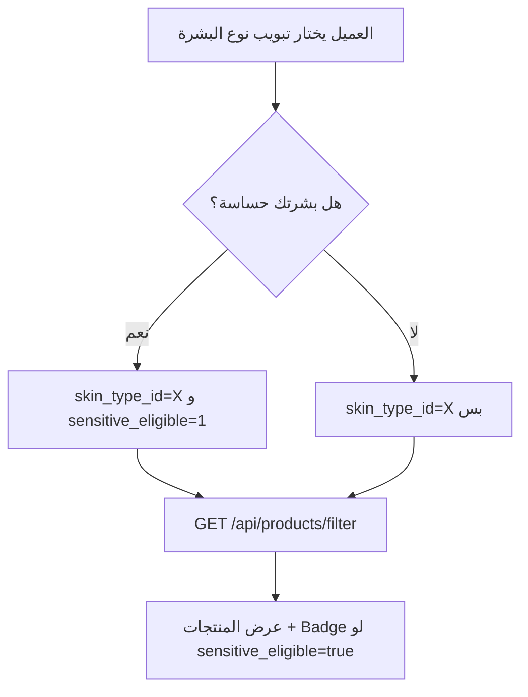

# 🧴 دليل API: سيكشن «تسوّق حسب نوع البشرة» (Shop by Skin Type)

> **Endpoint:** `GET /api/products/filter`
> **الفيتشر الجديد:** فلتر الحساسية `sensitive_eligible`

---

## 📩 الجزء الأول: استفسار فريق الفرونت (كما وصل)

> مرحباً يا هندسة،
>
> شغالين حالياً على سيكشن «تسوّق حسب نوع البشرة» (Shop by Skin Type) في الصفحة الرئيسية، ومحتاجين ننسق مع حضرتك بخصوص فلترة المنتجات لما العميل يختار خاصية البشرة الحساسة.
>
> **السيناريو في الـ UI:** العميل بيختار نوع بشرته الأساسي من التبويبات:
> `[ دهنية | مختلطة | عادية | جافة ]`
> وتحتها على طول بيجاوب على سؤال: «هل بشرتك حساسة؟» باختيار من اتنين: `[ نعم | لا ]`.
>
> **الاستفسار التقني:**
> 1. إيه اسم الـ Query Parameter المعتمد لاستقبال اختيار الحساسية؟ هل هو `sensitive_eligible=1` ولا `is_sensitive=1` ولا `skin_type_id=1&concern=sensitive`؟
> 2. هل الـ Query في الباك بيطبّق شرط التقاطع AND؟ (دهنية + حساسة = نعم ← منتجات للدهنية **وفي نفس الوقت** آمنة للحساسة؟)
> 3. في جدول الـ products، المنتج المناسب للبشرة الحساسة بيتميز إزاي؟ (عمود Boolean ولا Pivot Table؟)

---

## ✅ الجزء التاني: رد الباك إند

أهلاً يا شباب،

### 1. البارامتر المعتمد: `sensitive_eligible`

```http
GET /api/products/filter?skin_type_id=1&sensitive_eligible=1
```

| اختيار العميل | اللي يتبعت |
|---|---|
| **نعم** | `sensitive_eligible=1` |
| **لا** | ماتبعتوش البارامتر خالص (أو ابعتوا `0`)، وساعتها هترجع كل منتجات نوع البشرة اللي اخترتوه من غير فلترة على الحساسية |

- ❌ `is_sensitive`: ده بيستخدمه الـ Quiz بس (`EvaluateQuizRequest`)، مش الـ filter.
- ❌ `concern=sensitive`: مش مدعوم.

### 2. شرط التقاطع (AND): أيوه ✔️

لو اخترتوا (دهنية + حساسة = نعم)، هترجع المنتجات اللي **مرتبطة بالبشرة الدهنية وفي نفس الوقت** `sensitive_eligible = true`.
والشرطين دول بيتجمعوا بـ AND كمان مع باقي الفلاتر (brand, concern, price…).

### 3. التمييز في الداتابيز

- **الحساسية:** عمود Boolean في جدول `products` اسمه `sensitive_eligible`، والقيمة الافتراضية بتاعته `false`، والأدمن بيتحكم فيه من Filament.
- **نوع البشرة:** Pivot table (علاقة `skinTypes`) بنفلتر بيها عن طريق `skin_type_id`.
- كل منتج في الـ response بيرجع فيه `sensitive_eligible: true/false`، فتقدروا تحطوا Badge «مناسب للبشرة الحساسة» لو حبيتوا.

> [!IMPORTANT]
> ماتبعتوش «Sensitive» على إنه `skin_type_id` في التبويبات. التبويبات هي الأربعة الأساسية بس (دهنية/مختلطة/عادية/جافة)، والحساسية بتتحدد عن طريق `sensitive_eligible`.

---

## 📖 الجزء التالت: شرح تفصيلي

### 🧠 ليه فصلنا «نوع البشرة» عن «الحساسية»؟

الحساسية **مش نوع بشرة مستقل**، دي **صفة إضافية** ممكن تكون موجودة مع أي نوع:

```
دهنية + حساسة   ✔️ وارد
جافة  + حساسة   ✔️ وارد
مختلطة + مش حساسة ✔️ وارد
```

عشان كده الـ UI فيه سؤالين منفصلين، والباك بيتعامل معاهم كفلترين منفصلين:

| الطبقة | المصدر في الداتابيز | نوع العلاقة | البارامتر |
|---|---|---|---|
| نوع البشرة الأساسي | جدول `skin_types` + Pivot | Many-to-Many | `skin_type_id` |
| الأمان للبشرة الحساسة | عمود في `products` | Boolean | `sensitive_eligible` |

المنتج ممكن يناسب **أكتر من نوع بشرة** (عشان كده عملناه Pivot)، لكن «آمن للحساسة» إجابتها **يا آه يا لأ** (عشان كده عملناه Boolean).

---

### ⚙️ الباك بينفّذ الكلام ده إزاي؟

الكود في [ProductService.php](app/Services/ProductService.php) جوه دالة `filter()`:

```php
// 4. فلتر نوع البشرة: المنتج لازم يكون مربوط بالنوع ده في الـ Pivot
if (!empty($filters['skin_type_id'])) {
    $skinTypeIds = is_array($filters['skin_type_id']) ? $filters['skin_type_id'] : [$filters['skin_type_id']];
    $query->whereHas('skinTypes', function ($q) use ($skinTypeIds) {
        $q->whereIn('skin_types.id', $skinTypeIds);
    });
}

// 5c. فلتر الحساسية: بيتطبق بس لما القيمة تكون "نعم"
if (!empty($filters['sensitive_eligible']) && filter_var($filters['sensitive_eligible'], FILTER_VALIDATE_BOOLEAN)) {
    $query->where('sensitive_eligible', true);
}
```

**شرح السطور:**
- `whereHas('skinTypes', ...)`: بيرجّع المنتجات اللي ليها صف في الـ Pivot بالـ `skin_type_id` المطلوب.
- `!empty(...)`: لو البارامتر مش مبعوت أو قيمته `0`، الشرط **مابيتطبقش خالص**، فإجابة «لا» معناها «من غير فلترة» مش «هات المنتجات اللي مش آمنة للحساسة».
- `filter_var(..., FILTER_VALIDATE_BOOLEAN)`: بيقبل `1` و`true` و`"true"` كلهم.
- كل `where` في Laravel Query Builder بيتجمع مع اللي قبله بـ **AND** تلقائياً، وعشان كده التقاطع مضمون.

والـ Validation في [ProductFilterRequest.php](app/Http/Requests/API/GENERAL/ProductFilterRequest.php):

```php
'sensitive_eligible' => ['nullable', 'boolean'],
```

يعني القيم المقبولة: `1`، `0`، `true`، `false`. أي قيمة تانية (زي `yes`) هترجع **422 Validation Error**.

---

### 🔍 الـ SQL اللي بيتنفذ فعلاً (تقريباً)

لطلب `?skin_type_id=1&sensitive_eligible=1`:

```sql
SELECT * FROM products
WHERE stock > 0
  AND EXISTS (
      SELECT 1 FROM skin_types
      INNER JOIN product_skin_types ON skin_types.id = product_skin_types.skin_type_id
      WHERE product_skin_types.product_id = products.id
        AND skin_types.id IN (1)
  )
  AND sensitive_eligible = 1
ORDER BY created_at DESC;
```

> [!NOTE]
> المنتجات اللي `stock = 0` مابترجعش أصلاً في الـ filter.

---

### 🧪 أمثلة جاهزة للفرونت

| السيناريو في الـ UI | الطلب |
|---|---|
| دهنية + لا | `GET /api/products/filter?skin_type_id=1` |
| دهنية + نعم | `GET /api/products/filter?skin_type_id=1&sensitive_eligible=1` |
| جافة + نعم + ترتيب بالسعر | `GET /api/products/filter?skin_type_id=4&sensitive_eligible=1&sort=min_price` |
| مختلطة + نعم + براند معين | `GET /api/products/filter?skin_type_id=2&sensitive_eligible=1&brand_id=5` |

> [!WARNING]
> الـ IDs اللي فوق **أمثلة بس**. هاتوا الـ IDs الحقيقية من endpoint أنواع البشرة، أو راجعوا `SkinTypeSeeder`، وماتعملوش hardcode.

---

### 📦 شكل الـ Response (جزء من كل منتج)

```json
{
  "id": 12,
  "name": "Centella Calming Cleanser",
  "price": 450,
  "sensitive_eligible": true,
  "brand": { "...": "..." }
}
```

استخدموا `sensitive_eligible` عشان تعرضوا Badge 🛡️ «آمن للبشرة الحساسة» على كارت المنتج.

---

### 🔁 Flow مقترح في الفرونت



---

### ❓ أسئلة متوقعة

**س: لو اخترنا «لا»، هل هتظهر منتجات آمنة للحساسة؟**
أيوه، هتظهر. «لا» معناها إننا مش بنفلتر على الحساسية، مش إننا بنستبعد المنتجات الآمنة.

**س: ينفع نبعت أكتر من نوع بشرة؟**
أيوه: `skin_type_id[]=1&skin_type_id[]=2`، وده بيتعامل كـ **OR** بين الأنواع، و**AND** مع الحساسية.

**س: لو رجعت نتيجة فاضية؟**
ده معناه إن مفيش منتج للنوع ده متعلّم `sensitive_eligible = true`. ساعتها يتحل من لوحة الأدمن (Filament ← Products ← Toggle «Sensitive Eligible»)، مش من الفرونت.
